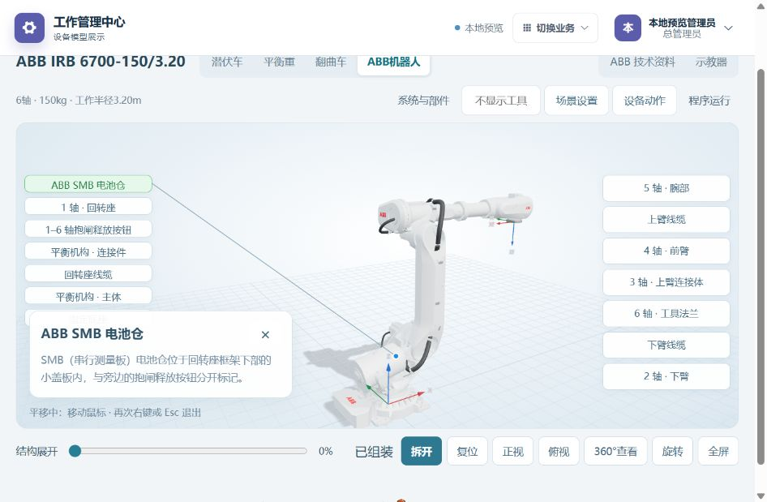
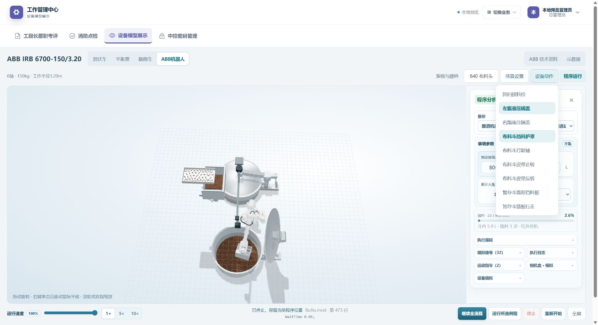

# ABB 交互与左右甑合盖 · 2026-11-06

V1.9.10 已于北京时间13:04同步网页。批次 abb-interactions-20261106；锅内速度反馈另行排查，本记录不代表其已修复。

电池仓资料按钮、专用页码传递及过期说明已从有效源码移除。部件本身及选中说明保留，ABB技术资料总入口保留。关联排查网页/Android/小程序，后三者共用页面或无独立对应入口，本轮无APK或微信发布。

右键在画布内单击后松开，移动鼠标即可平移，不需按住右键；再次右键、Esc、左键、离开画布、窗口失焦或切换视图退出。普通和360°视角共用此行为，触屏控制保留。平移同步移动相机与观察目标，保持视角方向及距离。

原合盖逻辑以未结束程序和全局相机位置拦截所有锅盖，暂停还冻结全部锅盖动画。现在对请求合盖的对应甑分别检查机器人/工具与相机实体是否进入锅盖运动范围，忽略不可见对象，并以组合坐标变换减少包围盒重复扩张。提示标明左/右甑和实际阻挡对象。空闲另一侧可以合盖；动画中重新出现占用则重新打开。此为展示模型几何判断，未接现场液压/控制器安全回路。

686项网页回归全通过，包含新增5项单击平移/退出/透视和正交/反向自由视角/左右占用/暂停合盖回归。生产构建通过。隔离浏览器选中SMB无资料按钮、右键松开平移与Esc退出、左右空甑合盖、机器人停左甑时右甑闭合和左甑受阻已操作核验；无控制台错误。Esc验证触发界面自动化停止后停止界面操作；用户随后要求打开预览，已单独恢复并展示预览入口。未以本机合成账号作为生产人工验收。

服务器重建完整1054文件网页目录，30个新/变文件、29个旧哈希资源从有效目录移出；7559项哈希/现场基线/公网入口资源/健康和鉴权检查通过。admin、brewing、raw_grain、viewer四类账号的备份、运动与离线模拟权限检查通过，临时会话清除，无业务写入。115份API/运行器源码与依赖文件、983份上传/私有资料、API和网页进程PID及Android24清单保持，不重启服务，无SQL、整站包或Git提交推送。

回滚目录 /opt/spare-parts/rollback/abb-interactions-20261106/web-dist-before，含manifest.json及RESTORE.json。先将现用web/dist移入本项目私有回收目录，再恢复该备份；API、数据库、配置、上传及Android不动。上一轮回滚仍保留。

[部署核验](../output/ABB_INTERACTIONS_20261106.json)。速度问题等待DSH结论，并由Codex独立核验后集成。
