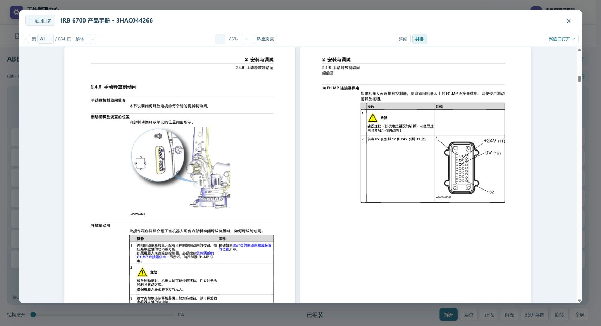
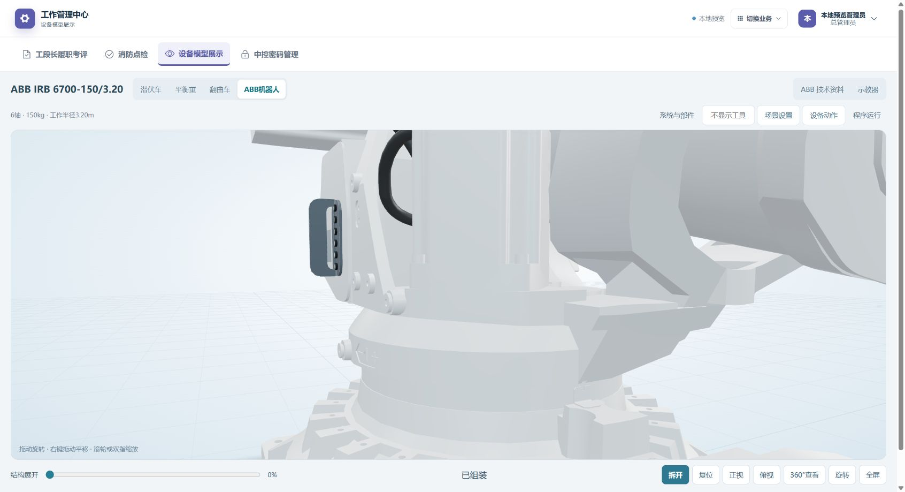

# ABB 模型与资料阅读修正 · 2026-11-06

当前 V1.9.10 网页已同步至服务器，最后批次 abb-brake-mount-20261106（北京时间 02:22），此前整合批次 abb-model-final-20261106。本次保留现有 Android24；无新 APK、整站交付包、SQL、Git 提交或推送。

## 技术资料阅读

DSH 交付 AbbRobotGuide、AbbDocumentReader、专用 AbbPdfReader 和 3 项组件测试；Codex 校验交付 SHA 后接手集成，修正组件相对路径、纸张宽高比、页码跳转、缩放定位、窗口尺寸重绘和章节新窗口链接。顶部以文档名称和手册号替换重复的“ABB 技术资料”，返回目录与标题同排，阅读工具集中在下一行；不再显示内部文档 id。

PDF 支持连续滚动、双页并排、缩放、适应宽度和直接跳页。实际浏览器打开 834 页产品手册，第81/82页并排、末页834跳转和连续布局通过；第81页附近共6个 canvas，非同时渲染834页。CHM 第29章“微动控制”与新窗口链接同步通过。示教器移除加减缩放按钮，实际滚轮缩放、右键平移及恢复正面通过，主视角只交换模型展示区域。

## 抱闸按钮与 SMB 盖板

依据仓库内 ABB 原厂《IRB6700 产品手册》3HAC044266-010 Rev AL 第81、187页及用户现场指示，电池小盖板位于抱闸护罩左侧（同一正面视角）。从原模型本体三角面分割独立选区，原本体移除对应面，避免叠加重复表面；未新增电池箱，细节尺寸仍为展示近似。

用户最新侧视图指出按钮在护罩前缘，已进一步修正：不能把护罩包围盒前缘或后沿当作按钮安装面。现在逐个用射线采样原 CAD 本体凹入面，六个圆形按钮背面贴在该面，正面位于护罩前缘之后，编号随按钮本体运动。没有补造安装板。回归同时检查接触、侧窗可见性、护罩前后关系及随1轴/拆解运动。浏览器正、侧面已独立检查。

## 联动与完整程序

AT20 与 DS77pro 合成一根杆、一个盒、两个镜头；待机收至双锅中间，上甑移到对应锅中心上方。重复显示/准备复用现有场景组，接料设备的显示开关不再错误复活或复制相机，运行时显示切换也不再触发回接料位。

测高、测温与红外区域请求独立计数，按模拟延迟反馈。DS77pro 读离线料面；AT20 仅模拟完成握手，没有实测温度值，不伪造 GI48。GO320=0 依照原程序 ModMain:188 释放命令并保持实际位置，3 才退避；不能清零实际位置导致后续区域等待卡住。

两锅盖同向置于锅局部-X侧；曲面薄壳、背面中心轴座、长摇臂、驱动曲柄和液压油缸联动，41个开合姿态检查机构接触及扫掠避让。锅盖尺寸、行程、开合3秒为离线估算，源EIO未明确对应实体液压阀信号；未把 Do105/Di105 原盖顶握手冒充油缸阀。

页脚状态、行号和代码以同一快照每秒至多更新一次，结束/停止/错误即时显示；未放慢机器人或改变程序运动速度。移除主工具栏“前进一步”，实体示教器原单步键保留。

实际私有备份离线执行器左右锅800mm均完成：各37次接料、8622段运动、22628次请求、237次红外扫描、38次测高、6次测温握手，均到 main 第339行退出。名义模拟秒数左822.07、右836.37；并非现场节拍实测。浏览器另完成左锅120mm跨红外循环，检查相机收回/隐藏和锅盖收尾。未将这些等同真机/控制器验收。

## 验证、部署与恢复

整合版网页677/API451项全通过、生产构建通过；最后按钮安装修正后再跑8项几何相关测试和新目录生产构建通过。整合批次1902项部署校验，最后网页修正1899项；四类实际启用角色的备份/运动/离线模拟权限通过，测试临时会话已清除。最后网页1054文件、30文件变化，无API变化；此前3个API修正继续保留。824份现场上传与私有文件和Android24校验保持。

最后网页回滚：/opt/spare-parts/rollback/abb-brake-mount-20261106/web-dist-before。仅撤销按钮修正时用该目录恢复网页即可；撤销整合批次还需恢复 /opt/spare-parts/rollback/abb-model-final-20261106/web-dist-before 及其中 api-before 的3个源码文件，并重启已核验的 spare-parts-api。各目录保留 manifest.json/RESTORE.json；先备份当前部署，保留数据库、上传、.env、.private 与 app-updates。

22个本次过期本地构建/载荷/临时图路径已移入 Windows 回收站；4个服务器本项目暂存目录移到 /opt/spare-parts/recycle-bin/abb-final-20261106，含 RESTORE.json。没有清空回收站，线上有效文件、历史回滚及最新核验构建保留。没有清理其他聊天的改动。

[完整校验记录](../output/ABB_MODEL_FINAL_VERIFY_20261106.json) · [当前部署](../output/CURRENT_DEPLOYMENT_V1.9.10.json)
