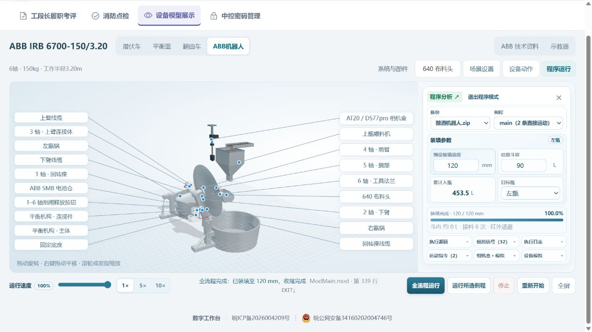

# ABB 程序播放性能修复 · 2026-11-06

V1.9.10 网页已于北京时间 10:48 同步，批次 abb-playback-performance-20261106。本轮只修改网页渲染和状态展示，不修改 RAPID 解释器、速度数据、轨迹、装填计算或信号等待逻辑。API 与 Android24 保持。

## 原因与修正

原渲染循环将每帧最多按50ms推进；实际掉帧超过50ms时丢失时间，导致动作随渲染负载变慢。现在按可见状态下真实经过时间插值；页面隐藏时暂停推进，恢复第一帧重置时钟，避免跳动。100%与1×仍使用既有程序速度数据及六轴限制，未以增大倍率掩盖性能问题。

原标签每80ms在完整CAD上重新遍历三角面和射线。现在缓存真实三角面上的局部附着点，随刚体矩阵变换；视角变化时重新挑选可见表面，隐藏/更换部件会刷新。没有把标签固定到包围盒空处。部件内同源材质共用，跨部件独立，选中高亮不会染到相邻部件。运动关节、源码和装填对象整体替换使用浅引用。

IO、FK、等待检查点常重复传递同一料面；现在只有锅、尺寸、高度、网格或沉积分布变化时才重建。等量物料换位置仍重建，不只按总量判断；倒料和高度联动继续使用原状态。

## 验证

Chrome CPU采样，正常100%/1×、标签开启，全场景运行。比较各自起始62943ms窗口：标签定位7815→334ms，料面更新6415→2659ms，材质setProgram9120→3405ms，Vue flushJobs7355→4651ms。两次浏览器采样独立，执行阶段可能略有差异；没有将结果宣称为FPS或全流程耗时提升比例。修复后完整采样376秒含流程结束后的空闲。

浏览器120mm完整主程序：6次接料、453.5L累计入甑，装填达到100%，最后ModMain.mod第339行EXIT。正常100%/1×，无控制台错误。重新开始回到起始位、清空进度；单独GoHome结束于第313行。800mm左右锅证据沿用上批次，本次没有重跑该离线用例，也不等同现场控制器或实机节拍验收。

681项网页全回归通过，其中新增4项性能边界检查覆盖慢帧时钟/隐藏恢复、刚体三角面附着、相同IO不重建及等量换位置重建、材质共用与高亮隔离。测试VM补入shallowRef；临时测试目录改为非隐藏路径后全通过。首次构建受系统Temp访问拒绝影响，指定任务临时目录后新目录生产构建通过。API源码未改，本轮没有重复跑API451项。

## 部署与恢复

完整1054网页文件，31个新/变化文件、30个过期哈希资源从有效部署中移出。6264项检查包括基线、载荷、部署目录、公网资源、受保护文件和健康接口；四类账号admin/brewing/raw_grain/viewer的备份、运动与离线模拟权限通过，临时测试会话已清除，无业务写入/AI调用。983份上传/私有资料、API文件、进程PID及Android24更新清单保持。未重启服务。

回滚目录：/opt/spare-parts/rollback/abb-playback-performance-20261106/web-dist-before，含manifest.json及RESTORE.json。先备份当前web/dist，再以该目录完整恢复web/dist即可；API、数据库、.env、上传、私有资料及Android不动。服务器暂存与本次本地旧构建在确认后可恢复回收，详见当前部署记录cleanup字段。

[部署检查](../output/ABB_PLAYBACK_PERFORMANCE_20261106.json) · [当前部署](../output/CURRENT_DEPLOYMENT_V1.9.10.json)

本轮收尾：5个本地旧构建/载荷/临时目录路径约210.5MiB已移入Windows回收站；其中dist回收的是旧构建，最新核验1054文件构建已归并回标准dist。服务器暂存已移到 /opt/spare-parts/recycle-bin/abb-playback-performance-20261106/staging，带RESTORE.json。必要回滚、原始性能采样与验证记录保留。8534预览验证完已关闭；本轮没有安排关机。
