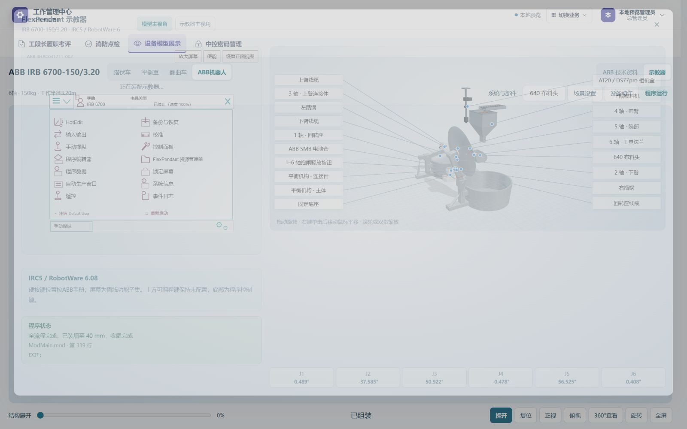
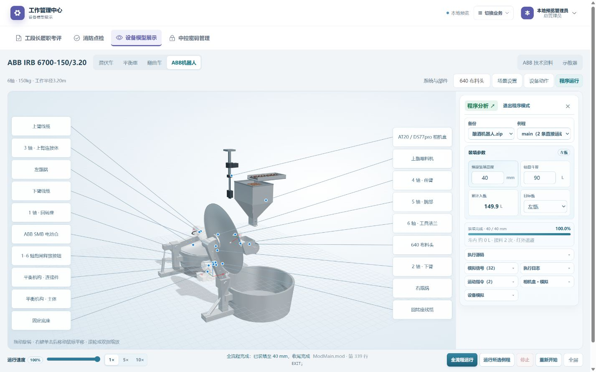

# ABB 速度、示教器与合盖交付 · 2026-11-06

V1.9.10 于北京时间13:26同步，批次 abb-local-speed-20261106。用户手动发起DSH只读排查，其报告已接收，由Codex独立复现、实现、测试及同步。没有新APK、整站归档包、SQL迁移、Git提交推送或微信发布。

## 行为

电池仓资料专用入口和过期跳页逻辑已移除；右键单击松开后移动鼠标平移，再次右键、Esc、左键或离开画布退出，普通/360°视角一致。电池仓部件及ABB资料总入口保留。

合盖逐甑检查锅盖完整运动区域里的机器人、工具与相机。另一侧正在运行也不全局禁用合盖；隐藏机械臂/相机不代表物理移走，仍参与占用判断；不显示工具时工具不参与。关闭过程中出现新占用则重新打开。启动整个工位的两盖预打开准备仍保留，不等同现场安全互锁。

示教器六轴角度条下移到右侧底部，与左侧状态内容底部对齐。它是只读角度监视，因此移除默认J1高亮和单独J1范围误导；每轴范围用悬停说明，手动操纵仍由示教器控制。

## 速度原因和实现

[DSH只读结论](ABB_DSH_FINDINGS_20261106.md)与Codex测量一致：锅内33–68ms短运动通常需两次HTTP往返，网络等待超过运动本身；0.01秒等待链又逐条往返。原speeddata/VelSet及六轴时长可信，页脚显示节流不在运动链上，不通过增加倍率补偿。

当前网页在独立Worker中直接打包同一份server纯数据解释器、锅/料面/红外模型，以及查看器的FK/IK与校正矩阵源码。备份仍从原有鉴权接口读取，Worker只在本机内存计算，不开网络/写备份/连控制器；每次只提交一段运动，仍沿用原会话提交、暂停、步进、回退、信号、等待时间与倍率语义。取消会终止计算，卸载释放Worker；不可用时回落原鉴权API，大JSON使用gzip，取消或换登录会话不发送旧请求。

注释处理抽成server/src/robot-code.js供ZIP索引/运动计划/解释器复用，避免把ZIP/私有配置模块带入浏览器。已完成运动后保留最近16个求解结果，求解重试期间不回收；状态UTF-8大小限制在两种运行时一致。

## 验证

- 最终692项网页、452项API全回归及生产构建通过。新增测试覆盖Worker同源依赖、FK/IK/WaitTime、取消/恢复/降级/源错误、gzip完整性/取消边界、求解缓存重试边界；另有左右占用和平移退出测试。
- 真实备份hash 01b7a45ee4996486ec6c300d249b1f1628ad152d23c1530c5fe31e42362406ad，120mm左甑直接解释器与Worker对照均1391段、6次接料、模拟累计147.77727493959398秒，最终cell（含料面/传感/物料）逐字段完全一致。Worker协议消息2331条留在本机，原解释器路径3720次调用；不是把2331条称为HTTP请求。
- 隔离浏览器40mm在100%/1×完整到ModMain.mod第339行EXIT，网络统计0条/simulate，控制台0错误。截取的是观察到完成的状态，未把工具轮询的观察间隔当作精确总耗时或FPS基准。
- 本轮缓存回收版本的左右800mm直接解释器路径各8622段、37次接料，均到800mm并收尾；该800mm结果不是Worker浏览器长流程实测。
- 页面实测SMB选中无专用资料按钮、右键松开平移/Esc退出、空闲另一甑合盖、占用本甑拦截；桌面角度条底部对齐，0个active输出。手机布局检查为本机浏览器，没有新原生/真机验收。

## 同步、边界和恢复

1055份完整网页（31个新/变化文件、29个旧哈希资源移出有效目录）及4份API文件已同步；仅重启spare-parts-api，网页两个PID保持。8714项基线/文件哈希/公网入口与Worker资产/健康/鉴权检查通过，后续再核对1055份网页完全一致、116份API与运行器文件及989份原有上传/私有资料保持预期。admin/brewing/raw_grain/viewer四类备份、运动与模拟权限通过，临时测试会话已清除，无业务写入/AI调用；Android24清单保持。

公网Worker返回200、JavaScript MIME和资产哈希正确，CSP worker-src允许self/blob。追加线上浏览器标签创建超时且未生成标签，故未声称已做生产账号的整页浏览器验收；本轮生产核验为HTTP/哈希/权限与服务核验，完整操作在本机隔离浏览器完成。未连接现场机器人、液压PLC、红外硬件或真机，不承诺真实控制器节拍。

回滚 /opt/spare-parts/rollback/abb-local-speed-20261106 保留web-dist-before、api-before、manifest.json与RESTORE.json。恢复前先将现用web/dist移入本项目私有回收目录，再恢复网页及三份原API源码；新增robot-code.js须与三份导入改动一同恢复/回收，不能单独移走仍被引用的文件；只重启spare-parts-api并核验健康。业务数据、上传、私有配置、Android及其他项目服务不动。前一交互批次回滚仍保留。

[当前部署](../output/CURRENT_DEPLOYMENT_V1.9.10.json) · [本批核验](../output/ABB_LOCAL_SPEED_20261106.json) · [协作范围](ABB_INTERACTION_COLLABORATION_20261106.md)。预览依用户要求保留在8534。

本轮收尾：11个本地旧构建/载荷/临时路径共630.5 MiB已移入Windows回收站；最新1055文件构建归并到标准dist并逐文件复核。两个服务器部署暂存目录已移到各自项目私有回收目录，带RESTORE.json，结果/权限回执复制进对应rollback。未永久删除或清空回收站。预览8534按用户要求保留。
