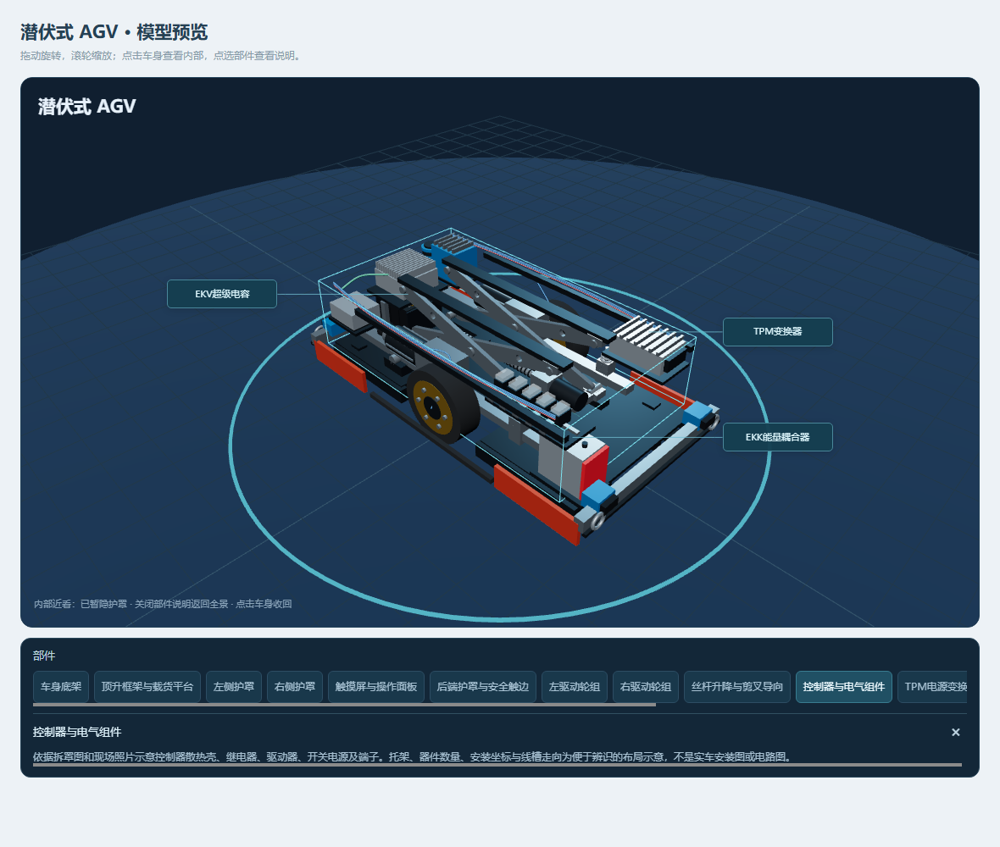
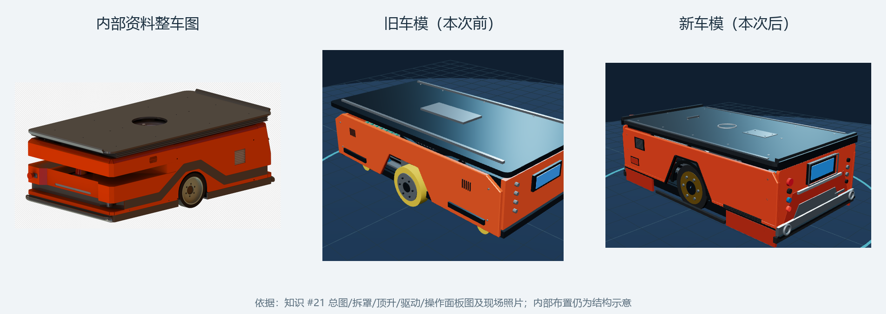

# AGV 车模按内部资料精修（2026-11-02）

2026/11/2 **15:29:37（北京时间）内部第二轮已上线**。只替换网页成品，API、数据库、私有配置、上传、微信小程序和 android.20 未改动；未生成整站交付包，未提交或推送 Git。

## 第二轮：内部结构与近看

- **底架与驱动**：底板、横梁给驱动轮留出空间；减速箱、电机、编码器与电气设备分区，补摆臂支点、调节座和螺旋弹簧。底部纵梁上移，与两块 THM 取电板实体分离。
- **顶升**：交叉臂分开厚度面，补中心销、滑块、横梁、螺母连接和限位；螺母连杆偏置到减速箱与伺服侧边，修正穿入自身驱动壳体的问题。90 mm 是资料额定举升值，本模型不模拟或验证举升运动。
- **电控与电源**：控制器、驱动器、开关电源、继电器/端子、TPM、EKK 和 EKV 分区，并补托架与线槽；THM 两块取电板保持独立。EKV 为超级电容，不是电池。安装位置、数量和接线只作辨识示意。
- **开口与传感器**：平台中央孔改为实际镂空，载荷开关杆置于平台上方；导航扫描头移至短端真实开孔内，而非被实心板挡住。
- **展开与聚焦**：内部设备留在底架，不再各自散开；THM 向侧上方分离展示，不穿入地面，不代表实际拆装路径。点选内部部件自动放大底架，并暂隐拆出的平台、护罩及未选中的 THM，避免俯视时被平台挡住。关闭部件说明恢复展开全景，点击车身仍可收回。
- 保留 15 个部件标识、部件选择、高亮和可横滑部件条；没有重新增加“展开/复原”按钮或下载入口。

[顶升近看](agv-model-20261102/internal-lift.png) · [390 宽手机布局](agv-model-20261102/internal-mobile.png)。截图是本机隔离预览，不是生产登录截图或实车 CAD。

### 第二轮验证与边界

- 前端 **395/395** 通过；新增的 [内部回归](../spare-parts-web-release/test/agv-model-internals.test.mjs) 含 4 项：部分命名硬实体静态分区、轮胎/取电板与底架、剪叉厚度面及连杆/驱动壳体、扫描孔与平台孔射线、载荷杆及展开离地检查。[选择回归](../spare-parts-web-release/test/agv-model-selection.test.mjs) 覆盖俯视后内部聚焦隐藏护罩、THM 自身可见和关闭说明恢复全景。
- 静态检测只覆盖选定实体，不覆盖所有未命名网格、线束、紧固件、装配接触或运动过程；**不等于整车无干涉或运动学验算**。
- 生产构建通过，701 文件、65,217,991 字节。构建仍有第三方 PURE 注释和大分块提示，无构建错误。
- Edge/SwiftShader 本机预览：桌面 1180×1000、手机 390×844，整车/展开/电控/顶升状态无渲染错误；文档宽度分别 1180/390，无整页横向溢出。部件条内部横滑是预期行为。最终底梁微调后另复截桌面。
- 线上完整 701 文件逐份大小/SHA256 与构建清单一致；index SHA256 为 `f06d893454e61305f5fac348abb508a64a1eb2db168541d69ccfa91b79de3570`，车模分块 SHA256 为 `47554b1de774a01b7af61cbef507313deb7b3e7f37e70a04294761b4dd56b8a6`。
- 服务器内网与经服务器访问 [公网入口](https://czsdsg.cn/) / [车模资源](https://czsdsg.cn/assets/AgvVehicles-CoAuoqyp.js) 均 200，资源哈希相同；API 健康 200，匿名访问车队接口仍为 401。107 份 API 源码、配置及网页运行器校验不变，API/网页/同机其他项目 PID 不变，未重启服务。
- 本机直接访问公网 HTTPS 遇到 TLS EOF/ECONNRESET，因此公网哈希核验是从服务器发起；没有绕过证书验证。未用生产账号打开最终车模页，QQ/微信、Safari、真实手机及现场机械装配仍未验收。
- 验证后已核对专属进程并关闭本轮 Vite 及测试浏览器，确认 8534/9222 端口释放，没有常驻测试服务；本机隔离资料仍保留。

### 第二轮留档与恢复

- 最终网页归档 27,031,666 字节，SHA256 `205237855ed7fc639aa9a53967f37b7a128cf49f8e835a047c953a253a48c8f0`。仅为本轮静态部署留档，不是完整项目交付包。
- 最终替换前网页保留在服务器私有回滚目录 `/opt/spare-parts/rollback/agv-internal-20261102-152937/web-before`；内部轮开始前的外观版另保留在 `/opt/spare-parts/rollback/agv-internal-20261102-152648/web-before`。第一轮之前的原始回滚也保持。
- 回滚目录含恢复步骤和清单；只替换网页目录，两次目录移动并非原子替换。不要覆盖 API、私有配置、数据库、上传或其他项目。
- 本轮上传包、清单及空暂存目录分别移至服务器项目私有回收目录 `agv-internal-20261102-152937` 与 `agv-internal-20261102-152648`，保留原路径和恢复说明，不永久删除。本机一张无引用的重复内部截图（233,347 字节）已移入 Windows 回收站，保留最终截图、顶升图、手机图与验证资料。

---

## 第一轮历史：外观精修（14:48 上线）

以下为首轮依据和当时的验证记录；当前内部状态以上述第二轮为准。

## 依据

- 知识库 #21《背负顶升AGV售后操作指导书》的总装图、整车渲染图、拆罩图、顶升图、驱动图和操作面板图。
- 说明书技术参数：外形 1310×700×460 mm，离地 15 mm，举升 90 mm，固定差速驱动。
- 知识 #19 的 THM 取电板、TPM 变换器、EKK 耦合器、EKV 超级电容清单。
- `public/models/agv-reference/` 下的 5 张现场实物照片（控制器散热壳、继电器、线束、驱动轮、SMARAGD 电源）。

模型仍由 `spare-parts-web-release/src/utils/agv-model.mjs` 在页面用 Three.js 程序化生成，不引入外部 GLB/STEP，不提供模型下载；内部器件位置、紧固件和线束仍为结构示意，不是制造 CAD，也不代表真实拆装顺序。

对照从左到右：知识 #21 的整车渲染图、本次前车模、本次后车模。截图来自本机 8534 预览，软件渲染。

## 本次修正

- **外形与比例**：按总图把车体收敛到 1310×700×460 mm、离地 15 mm；侧护罩改为上下两层，轮拱按主视图做成上窄下宽的梯形开口，并加轮拱内衬、水平分缝和下部橡胶条。
- **顶板**：薄平台、端部翻边、边梁、中央圆孔、检修口和 14 个周边孔位按顶视图重排；平台不再超出 1310 mm 车长。
- **操作面板**：确认在 700 mm 短端面；补圆角端板、触摸屏金属压边、梯形凹陷、手操器/通讯插头、急停、抱闸、急停灯和复位按钮。
- **前后端**：改为钢制保险杠加下部橡胶条、两侧拖车环；后端保留连接器、红色标牌和顶部指示灯。
- **驱动**：车轮前移到车体中部、轮面贴近护罩，金色轮辋和 6 颗螺栓；补减速电机、编码器、摆臂、减震和 4 个万向轮。
- **升降**：剪叉臂改为带三个减重孔的板件，补滑块、上下导轨、丝杆、螺母、伺服电机和到位开关。
- **电气**：控制器散热片、继电器组、驱动器、开关电源、线束分层；TPM/EKK/EKV 和两块 THM 取电板保持独立部件。
- **传感器**：导航雷达到平台下方，前后低位各补两个安全雷达。
- **展开布局**：15 个部件仍共用同一模型，展开偏移按上下、左右、前后分层，避免护罩挡住内部；部件说明同步改为“按图/按照片示意，需实车核对”。
- **视角**：默认相机降低俯角，桌面和手机都能完整看到整车与短端面板。

## 验证

- 前端 391/391 通过，其中新增 `test/agv-model-shape.test.mjs` 校验 1310×700×460 包络、15 个唯一部件、短端面板位置、平台顶面高度、驱动轮落地及无部件低于地面；`agv-electrical`、`agv-model-selection` 同步通过。
- 生产构建通过（2580 模块，dist 701 文件、65,214,692 字节）。
- 本机 8534 预览用 Edge/SwiftShader 实截桌面 1180×1000、手机 390×844、展开态和四视图；390 宽下文档宽度 390、画布 362，无横向溢出；点击车身能展开并出现 EKV/EKK/TPM/THM 标注。
- 线上替换：暂存 701 文件、index SHA256 `47bc5709…` 校验一致后替换 `/opt/spare-parts/web/dist`；`http://127.0.0.1:8503/` 返回 200，`AgvVehicles-BkoRixNL.js` 返回 200 且包含新包络字段。
- 公网 `https://czsdsg.cn/` 返回 200，index SHA256 与本地一致；公网 `assets/AgvVehicles-BkoRixNL.js` 返回 200。
- 以上是本机软件渲染和静态资源核验，不等于 QQ/微信浏览器、真实手机、苹果 Safari 或生产登录后的最终视觉验收，本轮未用真实账号打开生产车模页。

## 回滚

- 上一版网页：`/opt/spare-parts/rollback/agv-model-20261102/web-before`（701 文件，index SHA256 `964ba070…`），同目录 `RESTORE.md` 说明替换步骤，`MANIFEST.txt` 记录前后文件数、index 哈希、上传包哈希和本地 HTTP 结果。
- 恢复只替换 `/opt/spare-parts/web/dist`，不覆盖 API、`server/.env`、上传、MySQL 数据或同机其他项目。
- 历史上传归档 `web-dist-agv-model-20261102.tar.gz`（27,029,480 字节，SHA256 `39ef73d7…`）原存本机 `.local/agv-model-20261102/`，2026-11-03在全330模型交付后按用户要求移入系统回收站；线上同名旧上传包此前已移入私有回收目录。当前模型原始资料、不可变基线和必要生产回滚继续保留，不永久删除。

## 源码位置

- 模型：`spare-parts-web-release/src/utils/agv-model.mjs`
- 查看器与默认视角：`spare-parts-web-release/src/components/agv/AgvModelViewer.vue`
- 回归：`spare-parts-web-release/test/agv-model-shape.test.mjs`
- 预览：`spare-parts-web-release/test/fixtures/agv-model-preview.html`（本机 8534）
