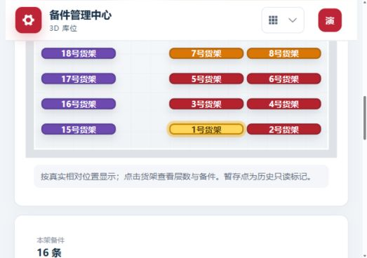

# 项目最终按钮与细节排查（2026-09-30，V1.9.9 full-final）

本次统一执行此前累积修改的本地回归，检查网页交互、小程序按钮、权限与依赖安全，并修复本轮发现的细节问题。当前交付：`spare-parts-v1.9.9-20260930-full-final.tar.gz`。本报告与包内 README、部署说明和 QA 顶部的当前说明为准；旧阶段的“未测试”“full-documents”等属于历史记录。

## 本轮新发现并修复

| 问题 | 修复后的行为 | 证据 |
|---|---|---|
| 2D 库位底部说明覆盖前排货架，点击 1 号货架无响应 | 说明移到图外，入口/方向文字不截获点击；选中货架恢复黄色 | 浏览器点击 1 号货架，出现 `plan-shelf active`、黄色 `rgb(255,214,90)`，加载本架 16 条；截图见下方 |
| 新建盘点、货架详情只读取前 200 条备件 | 按服务器分页补齐，保留车间/货架范围，重复页或不完整数据明确报错，超过 10000 条提示缩小范围 | 541 条、3 页、范围保持、取消旧请求及不完整分页回归通过 |
| 快速切换任务或货架范围时，晚到请求可能覆盖新选择 | 请求序号校验，取消过期结果；货架加载失败显示重试 | 取消请求回归；真实数据库及慢网真机另验 |
| 文档名称/链接未保存，切换事项、刷新或离开可能丢失 | 未保存修改先显示页面确认框，“继续编辑”保留草稿；浏览器关闭仍有原生离开保护 | 实际组件脚本执行测试：取消切换/刷新不加载不丢值，接受切换加载新绑定，保存期间不能切换 |
| 部署更新后旧页面的动态文件失效，导航看似没有反应 | 显示“页面未能加载”及明确刷新按钮，避免自动刷新丢失当前输入 | 本地更新构建后复现，通知出现；点击刷新后再次进入“程序智能分析”成功 |
| 小程序低库存清单缺少返回全部的直接按钮 | 新增“查看全部库存”，仅取消低库存条件，保留货区等范围 | 小程序页面真实 handler 的 VM 回归通过 |
| 小程序有库存、未配置订购点时误显示库存正常 | 显示“订购点未配置”；明确配置 0 的订购点仍按正常判断 | 页面数据处理回归通过 |
| 小程序低库存横条增加按钮后容易拥挤 | 允许横条换行，按钮维持小尺寸 | 源码检查；微信真机视觉验收未执行 |
| 盘点备件搜索图标缺少用途说明 | 添加搜索盘点备件的可访问名称及提示 | 模板检查和构建通过 |

## 累积修改一起纳入本包

- 移除补货重复查询/刷新清单、数据质量重复类型筛选及班长考评重复汇总；业务切换恢复下拉，基础维护使用一致按钮，导航按正常文档流布局。
- 工作记录把周选择放在记录表附近；日期、人员及刷新操作对齐；标题副说明颜色加深；详情标题及明显关闭入口调整；库存概况颜色恢复，手机操作栏换行，空的更多操作不显示。
- 管理员统一维护制曲标准，无需选择班长和生效周，修改保存立即执行，未改持续沿用；按基础工作、质量、设备、5S、安全分组，保留工作事项与评分标准增删，合计 25 分。班长按账号岗位/车间复核所属人员，不作为每周填报人。
- 在线文档和工作内容独立绑定，管理员可更新或解除，非法链接/越权/过期版本由服务端拦截；历史提交保留原链接。已接入三份指定 WPS 链接，填完文档返回系统上传本次工作截图，不声称自动读取 WPS 内容。
- 正常事项可选上传照片；异常按事项要求补充说明及材料。一次漏报、异常或未完成扣完该项本周基础分，重复事件不会扣成负数；休息日、未到期限不计漏报，已发布成绩保留快照。AI 仅建议，班长人工复核。
- 待填按日期/周/提交状态更新，异常的已提交记录仍视为已填；晚于提交的草稿不遮盖提交。在线文档事项在填报与周表显示名称、链接和截图要求。
- 制曲组长可进入备件中心阅读，写操作按岗位权限及服务端车间范围拦截。不得用“看到菜单”推断拥有写权限；生产账号历史权限数据是否异常尚未连接线上核验。
- 库存状态筛选增加明确的选中背景/文字与清除入口；原粮入口附近货架外移、排距与主过道加宽，地面方向标记后移；保持人工坐标及库位编号，选中货架黄色高亮。
- 保留同主版本 brace-expansion 安全补丁，未运行 audit fix --force。

## 检查范围与结果

| 检查 | 本次结果 | 范围限制 |
|---|---|---|
| 服务端 `npm test` | 268 / 268 通过 | Node 本地单元/路由 mock 回归，非生产数据库验收 |
| 网页 `npm test` | 98 / 98 通过 | 包含文档编辑保护、待填统计、完整分页、动态加载恢复、权限、库位等 |
| 网页 `npm run build` | 成功 | 存在大于 500 kB 的分块性能提示；不影响编译，未测低端手机首屏性能 |
| API、网页官方 npm audit | 均 0 项已知漏洞 | 2026-09-30 当次公告快照，非安全保证；镜像 audit 404 不算通过 |
| 小程序 JS 语法与 WXML handler 检查 | 20 个 JS 文件语法；13 个注册页面、70 多个绑定 handler 可调用 | 未在微信开发者工具或手机发布/运行 |
| 网页浏览器检查 | 备件阅读/详情关闭、导航、筛选入口、工程知识与程序分析、工作分类/文档标记、2D 货架选择与黄色、更新后恢复 | 合成数据；实际宽度约 529px 的窄视口，不等同 1280px 桌面或微信真机 |

检查使用 `.local/work-redesign/documents-preview.cjs` 的内存演示接口，仅测试数据，没有生产写入。测试日志保留在项目 `.local`，不进入部署包。

在线文档原生确认框在 IAB 自动化中使该临时标签无法继续操作，因此随后改用系统既有的页面确认框并补充实际组件回归；取消草稿和刷新保护的最新行为以组件测试为证据，未声称最新确认框已完成人工浏览器验收。不可把演示接口缺少统计分页当作生产故障。

## 修改后的实拍截图

以下为实际本地网页截图、合成数据；不是设计效果模拟图。仅选取修改部分：

## 部署与剩余验收

包内含部署说明、README、增量 SQL、小程序源码、网页成品、API 源码、模型资源和逐文件 SHA256 清单。网页与 API 必须同步升级；小程序需要使用包内源码重新编译、上传并发布。

上线前备份数据库与现有服务目录，在独立测试库验证启动增量迁移与真实角色权限，再上线。保留现场 `.env`、uploads、data 和数据库备份；**不要用 schema.sql 覆盖现有数据库，也不要批量执行历史 SQL/导入脚本**。本轮没有执行 MySQL 迁移、生产部署、微信开发者工具或真机验收，实际在线 WPS 内容不可自动获取。

经验：同一状态只保留一个操作入口，保存规则和禁用原因应显式显示；布局说明不得覆盖可点击区域；有分页的选择器不能默默截断；权限应分别控制菜单发现、数据范围和写动作；计分和提交状态分开计算；新包要从最新构建生成，并核对文件/资源/校验和，不能以旧阶段日志代替新验收。
