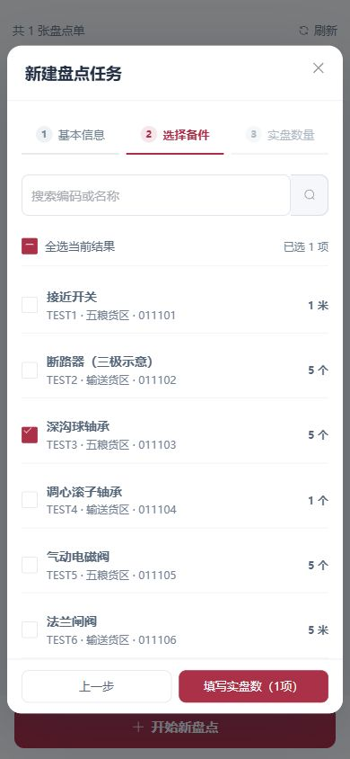

# 消防搜索、贴标补拍、App盘点及布料斗联动（2026-11-05）

## 本次修改

- 消防搜索优先完整器材编号，再匹配编号片段，最后才搜索位置/名称。保留点位完整快照与完成数，列表、台账和打印标签仅展开命中的器材；同编号的不同实物仍各自保留。权限范围先于搜索确定，全角/大小写统一，前导零不删除。
- 筒体贴标支持同一检查卡正面与两侧共最多3张现场照片，总大小8MB以内。每张单独送入现有图片模型，保存时将全部视角合成证据图并绑定核对票据；替换照片、顺序或账号会使旧票据失效。缺年度、错月、空白/模糊格和冲突仍不能自动通过，不降低0.95置信门槛。仍按原有六项检查表头校验；未取得现场失败原图，不能承诺不同版式已适配。
- App盘点独立列表：紧凑状态页签、整卡查看、底部开始盘点。去掉车间筛选，按账号权限读取；普通账号新建时带入所属车间，系统管理员仍可在新建单内确定实际车间。日期与新建表单控件统一46px高度。
- 新建盘点分基本信息、选择备件、实盘数量三步，居中弹窗，单层内容滚动；详情也改居中弹窗。去掉重复“选择备件”标题与全选按钮，保留一行搜索和“全选当前结果 / 已选项数”。保留输入零、未填数量拦截、关闭确认、失败保留填写和权限边界。
- 网页盘点单号列固定宽度；“差异”改“账实核对”，区分账实一致、账实不符与实盘数待核实。详情/通过/驳回在同一行，不将缺数旧记录显示成已核对正常。
- 两款布料斗的黄色皮带增加沿闭环表面的行走纹理，主动/从动滚筒同步旋转，不平移斗体或修改原CAD顶点。按实际备份EIO的DO18/19、DO20/21、DO22及转速组输出驱动正反转/启停，随演示速度变化。所选例程与全流程都发布运动前已执行的输出信号，停止冻结动作。DO22与皮带/打散轴联动为离线展示映射；未连接现场PLC，不宣称控制器硬件联锁验收，显示速度也不是实测m/s或RPM。
- ABB“重新开始”恢复按钮边框，mm/L放输入框右侧，移除用户指定的两段常驻说明。

## 昨日漏检说明

前次 `FINAL_USAGE_DELIVERY_20261105.md` 的消防验证仅覆盖初始化失败提示和控制器恢复，没有完成业务搜索与筒体贴标实图识别。前次“消防真实合成调用成功”只能证明通道可用，不能证明现场贴标可读。此次查到原线上存在被拦截识别记录，前次没有逐条追查。这是验证覆盖不足，不能以全站单测数量替代现场业务验收。

## 验证与边界

- 最终网页636/636、API419/419，生产构建19.63秒通过；另核对App三步选择的前置条件。
- 两款真实布料头：皮带纹理与两滚筒变化、正反转、恢复原位、框架及CAD顶点保持测试通过；既有护罩气缸/耙子避让测试仍通过。程序会话测试包含独立例程信号与运动前输出时序。
- 本机8534为唯一预览服务，消防启用显式隔离夹具。浏览器检查App盘点列表、去车间筛选、居中弹窗与步骤隔离；390宽表单弹窗宽374、左右留白各8。初版两个筛选控件均176×46，后按用户要求移除了车间筛选。
- 现有真实图片通道对合成完整检查卡、两张有重叠文字的补拍均识别为2026年11月、005、六项√。这是合成图调用，不能代替真实筒体反光/弧面/手写标签验收。未向生产业务表写入测试点检。
- 当前Android SDK缺少模拟器组件和AVD，没有本轮可操作原生模拟器。本轮未验收真机相机/扫码/系统日期选择器或微信体验版；未生成APK、上传微信或提交/推送Git。

## 上线与恢复

北京时间2026-11-05 09:28上线。通过4份API文件和完整网页树替换生效；传输复用哈希相同资源，重建后的网页目录1054份文件全部与本地对应构建一致，退役的29份旧构建文件仅留在回滚目录。1100项检查包含1058项文件哈希，不能解读为1100次业务操作。

线上10类实际账号按当前授权复核，5类可读角色各验证8个实际编号搜索；其他5类保持无消防授权。API未登录读取返回401，数据库健康为connected，三个公网页面返回当前构建入口。

上线前后：1003消防点位/器材、117点检记录、121照片、117单件检查映射、4异常、1盘点单、580库存记录数量一致；19份既有私有配置/业务文件哈希保持。未执行SQL迁移或业务写入，其他项目服务未更新。

回滚：`/opt/spare-parts/rollback/fire-app-20261105/`，内含完整旧网页、四份旧API与RESTORE.md；恢复时保留数据库、上传和新产生业务记录。部署暂存回收后，回收清单与恢复说明另存于该目录。

[部署核验](validation/20261105-fire-app/deployment.json) · [真实通道合成图结果](validation/20261105-fire-app/vision-probe.json) · [网页测试](validation/20261105-fire-app/web-tests.log) · [API测试](validation/20261105-fire-app/api-tests.log)

收尾：本地旧canonical dist、首轮构建及部署输入副本共4个目标已进入系统回收站；最终1054份成品转为唯一canonical dist并再次核对哈希。服务器部署暂存整体移入项目私有回收目录，当前回滚保留。预览8534按用户要求继续保留。补充浏览器验证已选1件、实盘0、返回前一步后0仍保留；未提交合成盘点。

[电脑回收清单](validation/20261105-fire-app/local-recycle.json) · [服务器暂存回收](validation/20261105-fire-app/staging-recycle.json)
